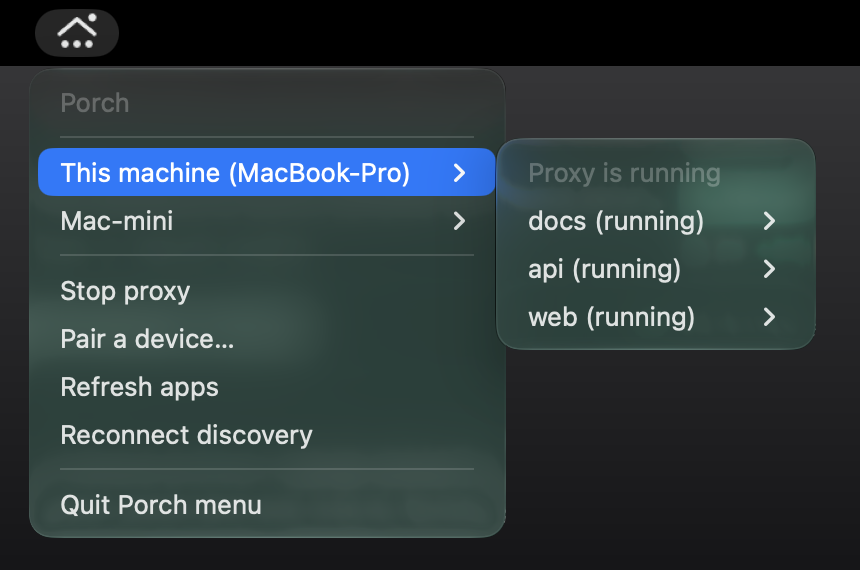

<p align="center">
  
</p>

<h1 align="center">Porch</h1>

<p align="center">
  Stable, named URLs for your dev servers, on this machine and on every machine you pair with.
</p>

<p align="center">
  <a href="https://github.com/akshitkrnagpal/porch/releases/latest"></a>
  <a href="https://github.com/akshitkrnagpal/porch/actions/workflows/ci.yml"></a>
  <a href="LICENSE"></a>
  
</p>

<p align="center">
  <a href="#install">Install</a> ·
  <a href="#quick-start">Quick start</a> ·
  <a href="#open-apps-on-your-other-machines">Other machines</a> ·
  <a href="docs/reference.md">Reference</a>
</p>

---

Porch runs your dev command, gives it a free port, and puts it behind a local proxy at a name you choose:

```console
$ porch run pnpm dev
http://web.localhost:7462 -> 4480
```

Your app gets the port as `PORT`, and `web.localhost` keeps pointing at it however many times you restart. Pair two machines and each one can open the other's apps the same way, for example `http://web.mac-mini.localhost:7462`.

## Features

- **Named URLs.** Apps live at `web.localhost`, `api.localhost` and so on, so bookmarks and OAuth callbacks keep working across restarts.
- **No sudo by default.** Browsers resolve `*.localhost` without hosts-file entries, and the proxy runs on port 7462 as your user. HTTPS is opt-in and doesn't need sudo either.
- **Framework flags.** Vite, Astro, Angular, React Router, Rsbuild, Expo, React Native and Wrangler get the right port and host flags with no config.
- **Monorepos.** Run `porch` at a pnpm, npm, Yarn or Bun workspace root and every package gets its own URL. Turborepo keeps its task graph and TUI.
- **Other machines.** Pair two machines with a 6-digit code and open each other's apps over your LAN or Tailscale. Traffic is encrypted and pinned to the other machine's certificate.
- **Menu bar and tray app.** Lists every app on every paired machine. Open an app, copy its URL, or start and stop the proxy.

## Install

**Homebrew** (macOS and Linux, CLI only):

```sh
brew install akshitkrnagpal/tap/porch
```

**Release archive** (CLI plus the menu bar or tray app). Download `porch-<version>-<target>.tar.gz` from the [latest release](https://github.com/akshitkrnagpal/porch/releases/latest) and check it against the release's `SHA256SUMS` file. Then, on macOS or Linux:

```sh
tar -xzf porch-*-aarch64-apple-darwin.tar.gz
python3 porch-*-aarch64-apple-darwin/install.py
```

This puts `porch`, `porch-tray` and `porch-login` in `~/.local/bin` and, on macOS, `Porch.app` in `~/Applications`. Use `porch` in a terminal and open `Porch.app` for the menu bar. The app carries its own copy of `porch`, so it keeps working if you move it. `install.py --cli-only` installs just `porch`. Each download is about 4 MB.

On Linux, `porch` needs only glibc 2.39 or newer (no OpenSSL). The tray also needs GTK 3 and an AppIndicator host.

On Windows, extract `porch-<version>-x86_64-pc-windows-msvc.tar.gz` with `tar -xzf` and run `py install.py` from the extracted folder. It installs `porch.exe` and `porch-tray.exe` to `%LOCALAPPDATA%\Programs\Porch\bin` and prints the command that adds that folder to your PATH.

[Release archive contents](packaging/README.md) lists what each archive holds.

**From source:**

```sh
cargo install --git https://github.com/akshitkrnagpal/porch porch
```

To update, run `porch self-update`. It replaces `porch`, the tray beside it and `Porch.app` in `~/Applications` (set `PORCH_APP_DIR` if you keep the app elsewhere, or rerun a newer `install.py`). On a Homebrew install it runs `brew upgrade` for you. Running apps and the proxy keep running while you update.

## Quick start

```sh
cd my-app
porch                      # runs the package's "dev" script at http://my-app.localhost:7462
porch run pnpm dev         # any command; the name comes from package.json or the folder
porch api node server.js   # choose the name: http://api.localhost:7462
porch alias db 5432        # name a server Porch didn't start
porch list                 # every route and whether it's answering
```

```console
$ porch list
HEALTH         URL -> TARGET
ok             http://web.localhost:7462  -> http://127.0.0.1:4480 (pid 28686)
not listening  http://db.localhost:7462  -> http://127.0.0.1:5432
```

Apps receive `PORT`, `HOST` and `PORCH_URL`. If an app ignores `PORT` and listens on a different port, Porch prints the port it found and the command to route to it. `porch doctor --fix` finds and repairs common problems such as a busy port, a dead route or a proxy left running by an older version.

For a guided first run, `porch setup` asks four questions (HTTPS, proxy port, start at login, sharing with other machines). You can run it again at any time to change your answers.

## Open apps on your other machines

On the machine running the apps:

```console
$ porch pair
Pairing code: 482913
```

On the machine you're using:

```console
$ porch pair 482913
Paired with Akshits-Mac-mini.local
```

Both machines can now see each other's apps:

```sh
porch list --all                          # this machine's apps and every paired machine's apps
porch open web --peer akshits-mac-mini    # http://web.akshits-mac-mini.localhost:7462
```

Remote apps are served through your own local proxy, so WebSockets, streaming and hot reload work as they do locally. Porch finds machines on your LAN and on your tailnet. Nothing is shared until you pair, and `porch unpair` revokes access on both sides.

To keep sharing on after a reboot, run `porch discovery autostart enable` on the machine with the apps. [Apps across machines](docs/discovery.md) covers the security model and the protocol.

## Menu bar and tray app

<p align="center">
  
</p>

On macOS, open `Porch.app`. On Linux, run `porch tray` (needs GTK 3 and an AppIndicator host). On Windows, run `porch tray` or `porch-tray.exe` to add Porch to the notification area.

The menu lists local apps and paired machines with their status. From it you can open an app, copy its URL, refresh, pair a new device, and start or stop the proxy. The icon's dots are solid while the proxy runs and dimmed when it stops, and a badge appears when a paired machine is reachable. On macOS and Linux, `porch-login enable` starts the app at login.

## More features

- **Public and tailnet URLs:** add `--tailscale`, `--funnel`, `--ngrok` or `--cloudflare` when you launch an app. Porch removes the share when the app exits.
- **Docker Compose:** `porch compose up` gives each HTTP service a name and a stable port.
- **Git worktrees:** a linked worktree on branch `fix/login` serves at `login.web.localhost`, so two checkouts of the same app don't collide.
- **HTTPS:** `porch proxy start --https` serves `https://web.localhost:7462` with HTTP/2 and a local certificate authority trusted for your user only, without sudo (macOS asks for your password or Touch ID once). Add `--port 443` to drop the port from URLs; binding port 443 needs sudo. `porch trust --system` trusts the CA machine-wide for command-line tools that ignore per-user trust stores.
- **Phones and tablets:** `--lan` publishes `web.local` over mDNS so other devices on your network can reach the app.
- **Coding agents:** `porch mcp` runs a stdio MCP server that lets an agent list routes and look up URLs.

## Coming from Portless

Porch is a Rust rewrite of [Portless](https://github.com/vercel-labs/portless) that adds pairing across machines and a native menu bar app. It reads `portless.json`, the `portless` key in `package.json`, and `PORTLESS_*` environment variables. When both exist, Porch's own `porch.json`, `porch` key and `PORCH_*` variables take precedence. See the [feature comparison](docs/feature-comparison.md) for each feature and how it's tested.

## Platform support

| Platform | Status |
| --- | --- |
| macOS, Apple Silicon | Supported, tested in CI |
| macOS, Intel | Release builds, not tested in CI |
| Linux x86_64 (glibc 2.39+) | Supported, tested in CI |
| Windows 10/11 x86_64 | Preview, tested in CI; some integration suites run on macOS and Linux only |

macOS builds aren't notarized. On Linux distributions older than glibc 2.39, build from source.

## Documentation

- [Command and configuration reference](docs/reference.md)
- [Apps across machines](docs/discovery.md)
- [Feature comparison with Portless](docs/feature-comparison.md)
- [Release archives, tray app and login startup](packaging/README.md)
- [Test suite](tests/README.md)

## Contributing

Issues and pull requests are welcome. To build and test:

```sh
cargo build --release
cargo test --all-targets
```

The tests start real processes, so you need Node.js with npm, Python 3 and Git. They use temporary state and never touch your hosts file, trust store or startup services. To build the menu bar app, run `cargo build --release --features tray --bins`. Release builds are optimized for size (fat LTO, one codegen unit), so they take a few minutes; plain `cargo build` is the quick one for day-to-day work. [Release size](docs/release-size.md) has the measurements behind these settings.

To cut a release, bump `version` in `Cargo.toml`, merge, then push a matching tag such as `v0.4.1`. The [release workflow](.github/workflows/release.yml) builds the archives and publishes the GitHub Release.

## License

[MIT](LICENSE)
