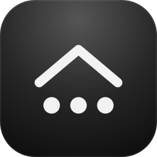
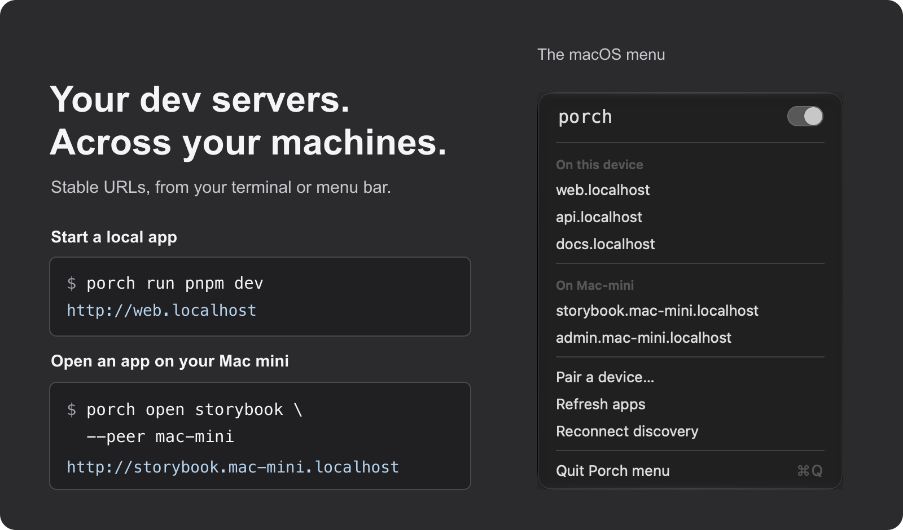

<p align="center">
  
</p>

<h1 align="center">Porch</h1>

<p align="center">
  Stable, named URLs for your dev servers, on this machine and on every machine you pair with.
</p>

<p align="center">
  <a href="https://github.com/akshitkrnagpal/porch/releases/latest"></a>
  <a href="https://github.com/akshitkrnagpal/porch/actions/workflows/ci.yml"></a>
  <a href="LICENSE"></a>
  
</p>

<p align="center">
  <a href="#install">Install</a> ·
  <a href="#quick-start">Quick start</a> ·
  <a href="#open-apps-on-your-other-machines">Other machines</a> ·
  <a href="#menu-bar-and-tray-app">Menu bar</a> ·
  <a href="docs/reference.md">Reference</a>
</p>

<p align="center">
  
</p>

Porch runs your dev command on a free port and gives it a name that stays the same across restarts. Pair another machine and open its apps from your terminal or the menu bar.

Your app receives its port as `PORT`. The image uses demo apps.

## Install

**macOS and Linux:**

```sh
curl -fsSL https://raw.githubusercontent.com/akshitkrnagpal/porch/main/scripts/install.sh | sh
```

Installing needs no sudo or Python. The installer verifies the checksum and, if the GitHub CLI is installed, the signed build attestation. If `porch` is not found, run `export PATH="$HOME/.local/bin:$PATH"` and add that line to your shell profile.

On macOS, the script also installs `Porch.app`. Open the menu with `open ~/Applications/Porch.app`.

On Linux, the default install is CLI only. For the tray on x86_64 Linux (glibc 2.39+, GTK 3 and an AppIndicator host):

```sh
curl -fsSL https://raw.githubusercontent.com/akshitkrnagpal/porch/main/scripts/install.sh | PORCH_TRAY=1 sh
```

There is no prebuilt tray for ARM64 Linux.

**Windows (PowerShell):**

```powershell
irm https://raw.githubusercontent.com/akshitkrnagpal/porch/main/scripts/install.ps1 | iex
```

Open a new terminal after installing to pick up the updated `PATH`; run `porch-tray.exe` for the tray.

**Homebrew** (macOS and Linux, CLI only): `brew install akshitkrnagpal/tap/porch`.

Update with `porch self-update`. Running apps and the proxy keep running while you update.

<details>
<summary>Release archives, platform requirements and building from source</summary>

**Release archive** (CLI plus the menu bar or tray app). Download `porch-<version>-<target>.tar.gz` from the [latest release](https://github.com/akshitkrnagpal/porch/releases/latest). Every archive has a signed build-provenance attestation, so you can check that this repository's release workflow built it: `gh attestation verify porch-*.tar.gz --repo akshitkrnagpal/porch`. For example, on an Apple Silicon Mac:

```sh
tar -xzf porch-*-aarch64-apple-darwin.tar.gz
python3 porch-*-aarch64-apple-darwin/install.py
```

This puts `porch`, `porch-tray` and `porch-login` in `~/.local/bin` and, on macOS, `Porch.app` in `~/Applications`. Use `porch` in a terminal and open `Porch.app` for the menu bar. The app carries its own copy of `porch`, so it keeps working if you move it. `install.py --cli-only` installs just `porch`. Each download is about 4 MB.

On Linux, the `x86_64-unknown-linux-gnu` archive (CLI and tray) needs glibc 2.39 or newer, and the tray needs GTK 3 and an AppIndicator host. The static `x86_64-unknown-linux-musl` and `aarch64-unknown-linux-musl` archives contain the CLI only and run on any distribution, including Alpine and ARM64 servers. Neither needs OpenSSL.

On Windows, extract `porch-<version>-x86_64-pc-windows-msvc.tar.gz` with `tar -xzf` and run `py install.py` from the extracted folder. It installs `porch.exe` and `porch-tray.exe` to `%LOCALAPPDATA%\Programs\Porch\bin` and prints the command that adds that folder to your PATH.

[Release archive contents](packaging/README.md) lists what each archive holds.

**From source:**

```sh
cargo install --git https://github.com/akshitkrnagpal/porch porch
```

</details>

## Quick start

```sh
cd web                    # a package named web
porch                      # runs the package's "dev" script at http://web.localhost
porch run pnpm dev         # any command; the name comes from package.json or the folder
porch api node server.js   # choose the name: http://api.localhost
porch alias storybook 6006 # name an existing HTTP server (not a database or other TCP service)
porch list                 # every route and whether it's answering
porch run -d pnpm dev      # in the background; then porch logs / porch stop
```

```console
$ porch list
  HEALTH  URL                         TARGET
● ok      http://web.localhost        http://127.0.0.1:4480 (pid 28686)
● ok      http://storybook.localhost  http://localhost:6006
```

URLs carry no port when your OS lets Porch serve port 80 without sudo (macOS, Windows, Linux with a lowered `net.ipv4.ip_unprivileged_port_start`). Elsewhere they look like `http://web.localhost:7462`. `porch get NAME` always prints the right one, and `PORCH_CLEAN_URLS=0` keeps port 7462.

Apps receive `PORT`, `HOST` and `PORCH_URL`. If an app ignores `PORT` and listens on a different port, Porch prints the port it found and the command to route to it. `porch doctor --fix` finds and repairs common problems such as a busy port, a dead route or a proxy left running by an older version.

For a guided first run, `porch setup` asks four questions (HTTPS, proxy port, start at login, sharing with other machines). You can run it again at any time to change your answers.

## Features

- **Named URLs with no port and no sudo.** Apps live at `http://web.localhost`, `http://api.localhost` and so on, so bookmarks and OAuth callbacks keep working across restarts. See [Quick start](#quick-start) for platform requirements and fallback URLs.
- **HTTPS without sudo.** `porch setup` turns on HTTP/2 over TLS with a local CA trusted for your user only. macOS asks for your password or Touch ID once; `porch trust --system` is available for tools that ignore user trust stores.
- **Framework flags.** Vite, Astro, Angular, React Router, Rsbuild, Expo, React Native and Wrangler, plus Django, Flask, FastAPI, uvicorn, gunicorn, Streamlit, MkDocs, Jupyter, Hugo, Jekyll and `python -m http.server`, get the right port and host flags with no config.
- **Monorepos.** Run `porch` at a pnpm, npm, Yarn or Bun workspace root and every package gets its own URL. Turborepo keeps its task graph and TUI.
- **Other machines.** Pair two machines with a 6-digit code and open each other's apps over your LAN or Tailscale. Traffic is encrypted and pinned to the other machine's certificate.
- **Menu bar and tray app.** Lists every app on every paired machine. Open an app, copy its URL, or start and stop the proxy. `http://localhost` is a dashboard of every running app.
- **Built for coding agents.** `porch mcp` and an installable [agent skill](skills/porch/SKILL.md) let Claude Code, Cursor and Codex find app URLs instead of guessing ports. See [Coding agents](docs/agents.md).
- **Diagnoses itself.** `porch doctor` checks the proxy, routes, name resolution and trust, exits non-zero when something is wrong, and `--fix` repairs what it safely can.

<details>
<summary>More integrations and sharing options</summary>

- **Public and tailnet URLs:** add `--tailscale`, `--funnel`, `--ngrok` or `--cloudflare` when you launch an app. Porch removes the share when the app exits.
- **Docker Compose:** `porch compose up` gives each HTTP service a name and a stable port.
- **Git worktrees:** a linked worktree on branch `fix/login` serves at `login.web.localhost`, so two checkouts of the same app don't collide.
- **Remote aliases:** `porch alias staging https://staging.example.com` puts a real site behind a local name, with verified TLS, the right `Host` and redirects that stay on the Porch URL.
- **Phones and tablets:** `--lan` publishes `web.local` over mDNS so other devices on your network can reach the app.
- **Coding agents:** `porch mcp` runs a stdio MCP server that lets an agent list routes, look up URLs and run diagnostics. Read-only tools can't change anything. Install the skill with `npx skills add akshitkrnagpal/porch`.

</details>

## Open apps on your other machines

On the machine running the apps:

```console
$ porch pair
Pairing code: 482913
```

On the machine you're using:

```console
$ porch pair 482913
Paired with Mac-mini.local
```

Both machines can now see each other's apps:

```sh
porch list --all                          # this machine's apps and every paired machine's apps
porch open storybook --peer mac-mini      # http://storybook.mac-mini.localhost
```

Remote apps are served through your own local proxy, so WebSockets, streaming and hot reload work as they do locally. Porch finds machines on your LAN and on your tailnet. Nothing is shared until you pair, `porch unpair` revokes access on both sides, and `--private` keeps an app off paired machines entirely. Paired machines only ever reach apps on this machine, never other hosts it can see.

To keep sharing on after a reboot, run `porch discovery autostart enable` on the machine with the apps. [Apps across machines](docs/discovery.md) covers the security model and the protocol.

## Menu bar and tray app

On macOS, run `open ~/Applications/Porch.app` after installing with the script or release archive. On x86_64 Linux, install with `PORCH_TRAY=1` as shown in [Install](#install), then run `porch tray`; GTK 3 and an AppIndicator host are required. ARM64 Linux builds and Homebrew installs contain the CLI only. On Windows, run `porch-tray.exe` to add Porch to the notification area.

The menu lists every app's URL at the top level: this machine's apps first, then each paired machine's (such as `storybook.mac-mini.localhost`), under a heading for each machine. Click a URL to open it; on macOS, hold Option to copy it instead (Linux and Windows show Open and Copy in a small submenu). The switch beside Porch starts or stops the proxy, and the menu also refreshes apps and pairs a new device. The icon's dots are solid while the proxy runs and dimmed when it stops, and a badge appears when a paired machine is reachable. On macOS and Linux, `porch-login enable` starts the app at login (requires Python 3 and an installed tray).

## Coming from Portless

Porch is a Rust rewrite of [Portless](https://github.com/vercel-labs/portless) that adds pairing across machines and a native menu bar app. It reads `portless.json`, the `portless` key in `package.json`, and `PORTLESS_*` environment variables. When both exist, Porch's own `porch.json`, `porch` key and `PORCH_*` variables take precedence. See the [feature comparison](docs/feature-comparison.md) for each feature and how it's tested.

## Platform support

| Platform | Status |
| --- | --- |
| macOS, Apple Silicon | Supported, tested in CI |
| macOS, Intel | Release builds, not tested in CI |
| Linux x86_64 (glibc 2.39+) | Supported, tested in CI |
| Linux x86_64 and ARM64, any distribution (static) | CLI only, release builds |
| Windows 10/11 x86_64 | Preview, tested in CI; some integration suites run on macOS and Linux only |

macOS builds aren't notarized yet. On Linux distributions older than glibc 2.39, use the static `musl` archive.

## Documentation

The docs are also a searchable site: run `mdbook serve` in this repository, or read the copy the [docs workflow](.github/workflows/docs.yml) publishes to GitHub Pages from `main`. Start with [Getting started](docs/introduction.md).

- [Command and configuration reference](docs/reference.md)
- [Recipes](docs/recipes.md): Next.js, Vite, Django, Rails, Docker Compose, monorepos, OAuth, phones
- [Troubleshooting](docs/troubleshooting.md)
- [Coding agents](docs/agents.md): MCP setup for Claude Code, Cursor, Codex and VS Code
- [`porch.json` schema](schema/porch.schema.json) and [examples](examples)
- [Changelog](CHANGELOG.md)
- [Apps across machines](docs/discovery.md)
- [Feature comparison with Portless](docs/feature-comparison.md)
- [Release archives, tray app and login startup](packaging/README.md)
- [Test suite](tests/README.md)

## Contributing

Issues and pull requests are welcome. To build and test:

```sh
cargo build --release
cargo test --all-targets
```

The tests start real processes, so you need Node.js with npm, Python 3 and Git. They use temporary state and never touch your hosts file, trust store or startup services. To build the menu bar app, run `cargo build --release --features tray --bins`. Release builds are optimized for size (fat LTO, one codegen unit), so they take a few minutes; plain `cargo build` is the quick one for day-to-day work. [Release size](docs/release-size.md) has the measurements behind these settings.

To cut a release, bump `version` in `Cargo.toml`, merge, then push a matching tag such as `v0.5.0`. The [release workflow](.github/workflows/release.yml) builds the archives and publishes the GitHub Release.

## License

[MIT](LICENSE)
